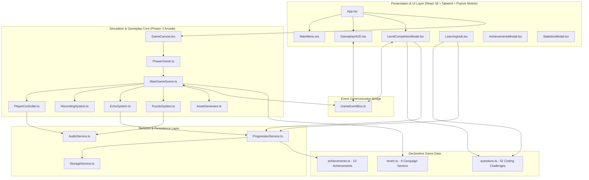

# ARCHITECTURE SPECIFICATION – AFTERIMAGE: THE LAST ECHO

## 1. System Architecture Overview

---

## 2. Core Design Decisions

1. **Separation of Concerns: Phaser vs React**:
   - Phaser 3 owns the canvas rendering, 60 FPS update loop, world collisions, kinematics, and particle systems.
   - React owns high-level UI states: menus, tactical advisory hints, HUD overlays, code challenge evaluation modals, and analytics charts.
   - Decoupled via `GameEventBus`, ensuring zero unnecessary React re-renders during 60 FPS gameplay.

2. **Deterministic Echo Recording (Kinematic Timeline Sampling)**:
   - Rather than relying on non-deterministic physics replay or AI agents, `RecordingSystem` samples player coordinate transforms, velocities, and interaction flags at a fixed 60Hz rate into compact arrays.
   - `EchoSystem` replays these tracks using binary-search timeline sampling and linear interpolation. This guarantees reproducible, glitch-free puzzle solutions across runs.

3. **Sensor-Based Puzzle Triggering**:
   - Echoes do not require physical collision bodies that could push walls or glitch through solid geometry.
   - Instead, echoes interact through dedicated Phaser trigger sensor zones in `PuzzleSystem.ts`.

4. **Educational Integrity ("Learn to Earn")**:
   - No forced advertising, energy timers, or paywalls.
   - Players earn bonus XP by solving output prediction and algorithm challenges across Python, JavaScript, C, C++, and Java.
   - Safe client evaluation: evaluated against canonical answer indices without using unsafe `eval()`.
   - Anti-farming protection: records solved challenge IDs to reward XP only once per question.

5. **Robust Audio via Web Audio API**:
   - Procedural futuristic audio synthesis using `AudioContext` oscillators, envelopes, and gain nodes.
   - Zero external audio file download dependencies, zero latency, and zero broken asset paths.

