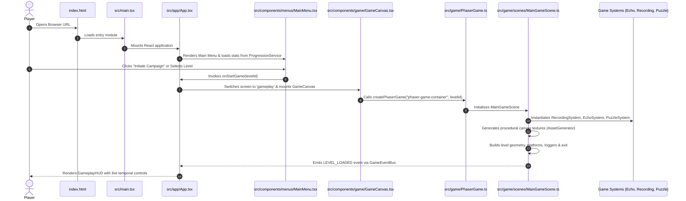

# CODE MAP – AFTERIMAGE: THE LAST ECHO

This document provides a complete technical guide to the codebase architecture, file dependencies, lifecycle calls, and startup execution flow for **AFTERIMAGE: The Last Echo**.

---

## 1. Application Startup Sequence



---

## 2. Core Architecture & Module Dependency Matrix

| File Path | Called / Imported By | Calls / Depends On | Primary Responsibility | Events Emitted / Handled |
|---|---|---|---|---|
| [`src/main.tsx`](file:///e:/shivam-personal/AFTERIMAGE%20–%20The%20Last%20Echo/src/main.tsx) | `index.html` | `React`, `ReactDOM`, `App.tsx`, `index.css` | React DOM mount root | None |
| [`src/app/App.tsx`](file:///e:/shivam-personal/AFTERIMAGE%20–%20The%20Last%20Echo/src/app/App.tsx) | `main.tsx` | `MainMenu`, `GameCanvas`, `GameplayHUD`, `LevelCompletionModal`, `LearningHub`, `AchievementsModal`, `StatisticsModal` | Main UI state router, switching screens and toggling modals | Listens: `LEVEL_COMPLETED`. Emits: `SET_CURRENT_LEVEL`, `TRIGGER_RESTART` |
| [`src/components/game/GameCanvas.tsx`](file:///e:/shivam-personal/AFTERIMAGE%20–%20The%20Last%20Echo/src/components/game/GameCanvas.tsx) | `App.tsx` | `PhaserGame.ts`, `GameEventBus.ts` | Mounts and manages lifecycle of the Phaser HTML5 Canvas | Emits: `SET_CURRENT_LEVEL` |
| [`src/game/PhaserGame.ts`](file:///e:/shivam-personal/AFTERIMAGE%20–%20The%20Last%20Echo/src/game/PhaserGame.ts) | `GameCanvas.tsx` | `Phaser`, `MainGameScene.ts` | Configures and launches Phaser 3 instance (Arcade physics, scale FIT) | Starts: `MainGameScene` |
| [`src/game/scenes/MainGameScene.ts`](file:///e:/shivam-personal/AFTERIMAGE%20–%20The%20Last%20Echo/src/game/scenes/MainGameScene.ts) | `PhaserGame.ts` | `AssetGenerator`, `PlayerController`, `RecordingSystem`, `EchoSystem`, `PuzzleSystem`, `AudioService`, `GameEventBus` | Central gameplay loop, physics collision management, level loading | Emits: `LEVEL_LOADED`, `LEVEL_COMPLETED`, `PLAYER_DIED`. Listens: `TRIGGER_RECORD`, `TRIGGER_REPLAY`, `TRIGGER_RESTART`, `SET_CURRENT_LEVEL` |
| [`src/game/entities/PlayerController.ts`](file:///e:/shivam-personal/AFTERIMAGE%20–%20The%20Last%20Echo/src/game/entities/PlayerController.ts) | `MainGameScene.ts` | `Phaser`, `AudioService` | Player kinematic movement (WASD/arrows), jump physics, interaction intent | Plays: `jump` |
| [`src/game/systems/RecordingSystem.ts`](file:///e:/shivam-personal/AFTERIMAGE%20–%20The%20Last%20Echo/src/game/systems/RecordingSystem.ts) | `MainGameScene.ts` | `GameEventBus`, `AudioService`, `types/index.ts` | Fixed-rate 60Hz transform sampling of player positions and actions | Emits: `RECORDING_STARTED`, `RECORDING_STOPPED`, `RECORDING_UPDATE` |
| [`src/game/systems/EchoSystem.ts`](file:///e:/shivam-personal/AFTERIMAGE%20–%20The%20Last%20Echo/src/game/systems/EchoSystem.ts) | `MainGameScene.ts` | `Phaser`, `GameEventBus`, `AudioService`, `ProgressionService` | Temporal playback of recorded paths with binary search time interpolation | Emits: `ECHO_SPAWNED`, `ECHO_EXPIRED` |
| [`src/game/systems/PuzzleSystem.ts`](file:///e:/shivam-personal/AFTERIMAGE%20–%20The%20Last%20Echo/src/game/systems/PuzzleSystem.ts) | `MainGameScene.ts` | `Phaser`, `GameEventBus`, `AudioService` | Logic for pressure plates, toggle switches, timed switches, and sliding blast doors | Emits: `PLATE_TRIGGERED`, `SWITCH_TOGGLED`, `DOOR_STATE_CHANGED` |
| [`src/game/events/GameEventBus.ts`](file:///e:/shivam-personal/AFTERIMAGE%20–%20The%20Last%20Echo/src/game/events/GameEventBus.ts) | All game & UI modules | Standard TypeScript Event Dispatcher | Decoupled event-driven bridge between Phaser Canvas and React HUD | Dispatches typed events |
| [`src/game/graphics/AssetGenerator.ts`](file:///e:/shivam-personal/AFTERIMAGE%20–%20The%20Last%20Echo/src/game/graphics/AssetGenerator.ts) | `MainGameScene.ts` | `Phaser` | Procedural generation of textures (player, echo ghost, switches, plates, doors, lasers) | Creates reusable texture keys |
| [`src/data/levels.ts`](file:///e:/shivam-personal/AFTERIMAGE%20–%20The%20Last%20Echo/src/data/levels.ts) | `MainGameScene`, `MainMenu`, `GameplayHUD` | `types/index.ts` | Declarative definitions of all 9 campaign levels across Acts 1, 2, and 3 | Level coordinates, targets, hints |
| [`src/data/questions.ts`](file:///e:/shivam-personal/AFTERIMAGE%20–%20The%20Last%20Echo/src/data/questions.ts) | `LevelCompletionModal`, `LearningHub`, unit tests | `types/index.ts` | 52 verified educational programming questions (Python, JavaScript, C, C++, Java) | Challenge definitions & answers |
| [`src/data/achievements.ts`](file:///e:/shivam-personal/AFTERIMAGE%20–%20The%20Last%20Echo/src/data/achievements.ts) | `ProgressionService`, `AchievementsModal` | `types/index.ts` | Achievement registry and XP values | Milestone conditions |
| [`src/services/progression/ProgressionService.ts`](file:///e:/shivam-personal/AFTERIMAGE%20–%20The%20Last%20Echo/src/services/progression/ProgressionService.ts) | `MainGameScene`, `MainMenu`, `HUD`, `Modals` | `StorageService`, `achievements.ts` | Calculates XP, tracks completion times, awards achievements, prevents reward farming | Persists stats |
| [`src/services/storage/StorageService.ts`](file:///e:/shivam-personal/AFTERIMAGE%20–%20The%20Last%20Echo/src/services/storage/StorageService.ts) | `ProgressionService`, `AudioService` | Browser `localStorage` with SSR/Node safety fallback | Validates, migrates, and serializes save schemas | None |
| [`src/services/audio/AudioService.ts`](file:///e:/shivam-personal/AFTERIMAGE%20–%20The%20Last%20Echo/src/services/audio/AudioService.ts) | `MainGameScene`, `PlayerController`, `Systems` | Web Audio API (`AudioContext`) | Synthesizes futuristic SFX (jumps, recording buzz, echo replay, doors, chimes) | Sound synthesis |

---

## 3. Frequently Asked Architecture Questions

### Where does movement happen?
In [`src/game/entities/PlayerController.ts`](file:///e:/shivam-personal/AFTERIMAGE%20–%20The%20Last%20Echo/src/game/entities/PlayerController.ts). The `update()` method polls input keys, sets horizontal velocity (`MOVE_SPEED = 240`) and vertical impulse (`JUMP_VELOCITY = -440`) via Phaser Arcade physics.

### Where is movement recorded?
In [`src/game/systems/RecordingSystem.ts`](file:///e:/shivam-personal/AFTERIMAGE%20–%20The%20Last%20Echo/src/game/systems/RecordingSystem.ts). When the player presses `R`, `startRecording()` initiates sampling. Every tick, `recordFrame()` samples timestamps, coordinates `(x, y)`, velocity vectors `(vx, vy)`, flip direction, and interaction states.

### How is an echo created and replayed?
In [`src/game/systems/EchoSystem.ts`](file:///e:/shivam-personal/AFTERIMAGE%20–%20The%20Last%20Echo/src/game/systems/EchoSystem.ts). Pressing `E` calls `spawnEchoFromLastRecording()`. An ethereal arcade sprite (`echo_ghost`) is instantiated without gravity and interpolates smoothly along the recorded timeline samples using `samplePlayback()`.

### How does an echo activate a pressure plate?
In [`src/game/systems/PuzzleSystem.ts`](file:///e:/shivam-personal/AFTERIMAGE%20–%20The%20Last%20Echo/src/game/systems/PuzzleSystem.ts). `checkCollisions()` tests physics overlap between the plate's trigger sensor zone and both the live player sprite and all active echo sprites. If an echo is standing on the plate zone, `plate.isPressed` is marked true.

### How does a door know when to open?
In `PuzzleSystem.ts`:
```ts
let shouldOpen = true;
for (const plateId of door.reqPlateIds) {
  if (!this.plates.get(plateId)?.isPressed) shouldOpen = false;
}
for (const switchId of door.reqSwitchIds) {
  if (!this.switches.get(switchId)?.isActive) shouldOpen = false;
}
```
When all linked conditions evaluate to true, `setDoorState()` animates the sliding door open and disables its solid physics body.

### Where are questions loaded & evaluated?
In [`src/data/questions.ts`](file:///e:/shivam-personal/AFTERIMAGE%20–%20The%20Last%20Echo/src/data/questions.ts), [`src/components/hud/LevelCompletionModal.tsx`](file:///e:/shivam-personal/AFTERIMAGE%20–%20The%20Last%20Echo/src/components/hud/LevelCompletionModal.tsx), and [`src/components/menus/LearningHub.tsx`](file:///e:/shivam-personal/AFTERIMAGE%20–%20The%20Last%20Echo/src/components/menus/LearningHub.tsx). Player answer submissions pass to `ProgressionService.recordQuestionResult()`, which verifies correctness against `correctAnswerIndex`, records the concept, and prevents duplicate XP farming.

