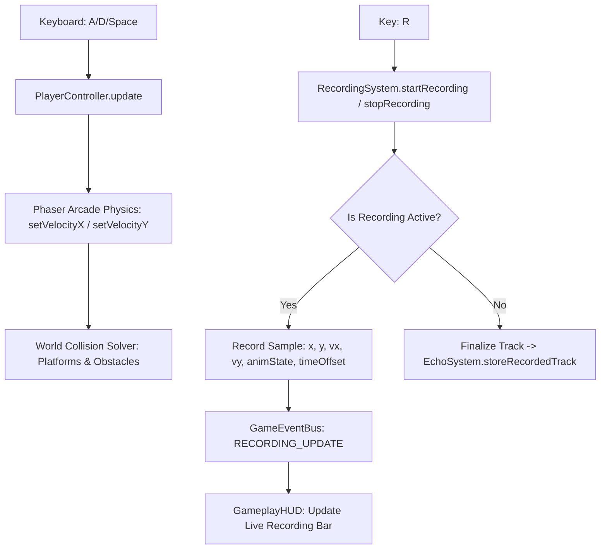
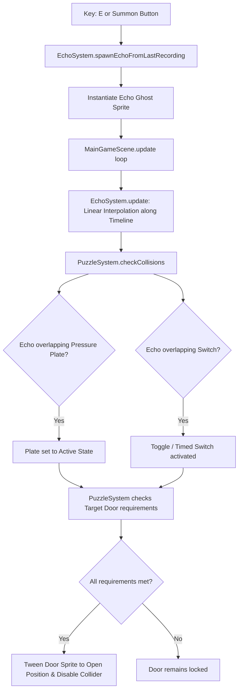
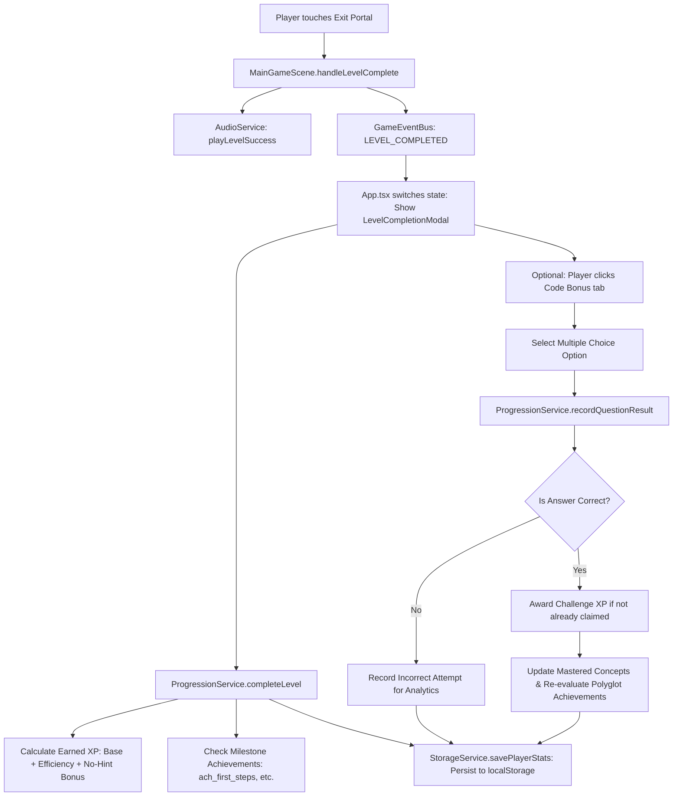

# DATA FLOW SPECIFICATION – AFTERIMAGE: THE LAST ECHO

This document details how data and signals flow through the application during each stage of interaction.

---

## 1. Player Input to Movement & Recording

---

## 2. Echo Playback to Puzzle Activation Flow

---

## 3. Level Completion, Educational Challenge & Progression Flow

